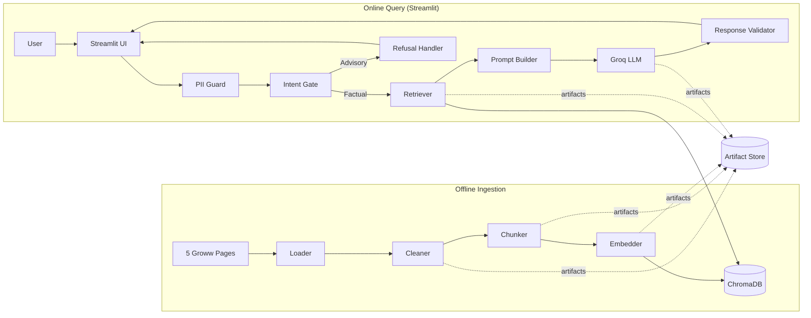
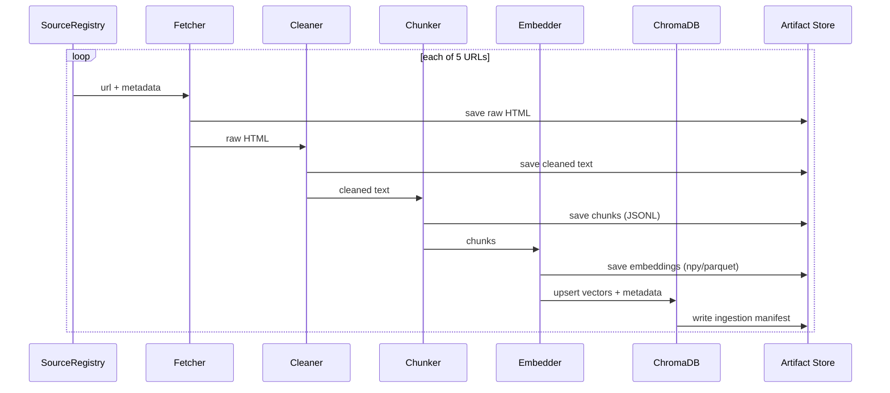
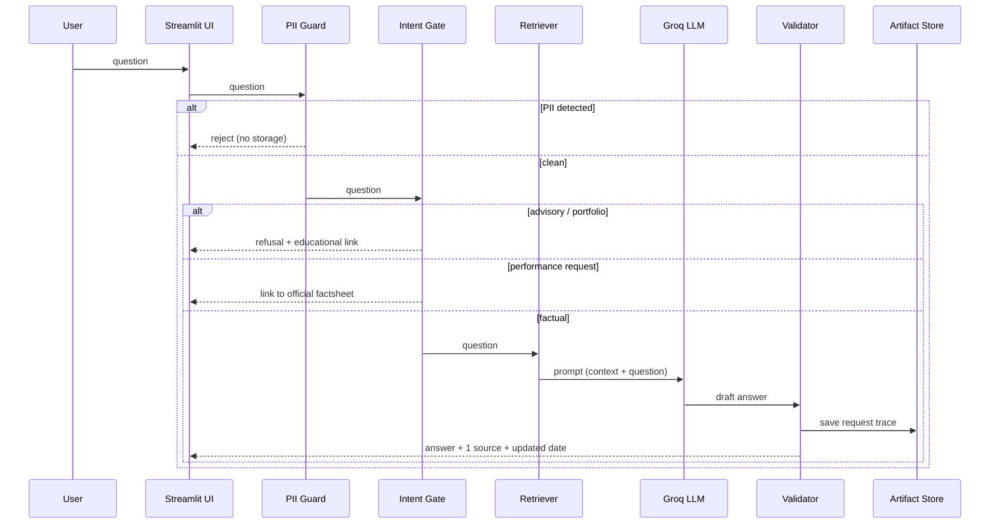

# Architecture: Groww Mutual Fund FAQ Assistant

**Derived from:** `docs/PRD.md`
**System type:** Retrieval-augmented generation (RAG) FAQ assistant
**Scope:** HDFC Mutual Fund — 5 public Groww pages only
**UI framework:** Streamlit

---

## 1. Architectural Goals

| Goal | Design response |
|------|-----------------|
| Facts only, always cited | Retrieval-grounded generation with a mandatory single citation per answer |
| No investment advice | Pre-generation intent gate + advisory refusal path |
| Full RAG demonstrability | Each stage writes explicit, inspectable artifacts to disk |
| Swappable components | Config-driven embedding model, vector DB, and LLM provider/model |
| Small corpus | Local embeddings + local ChromaDB; no distributed infra needed |
| Privacy | PII detection/redaction before any processing or logging |
| Simple usability | A single Streamlit interface for asking questions and viewing cited answers |

---

## 2. System Overview

The system is a three-tier local application:

1. **Offline ingestion pipeline** — scrape → clean → chunk → embed → store (run once / on refresh).
2. **Online query pipeline** — validate/PII check → intent gate → retrieve → generate → post-validate → respond.
3. **Presentation layer** — a Streamlit UI exposing the assistant, including the welcome message, three example questions, input box, answer area with source link, and the "Facts-only. No investment advice." note.

The Streamlit UI invokes the query pipeline in-process and renders the validated answer, source link, and updated date.



---

## 3. Component Architecture

### 3.1 Ingestion Layer (offline)

| Component | Responsibility | Key decisions |
|-----------|----------------|---------------|
| `SourceRegistry` | Holds the fixed list of 5 URLs + metadata (scheme, type, page label) | Hard allowlist; crawler refuses any URL not in registry |
| `Fetcher` | HTTP GET each page, save raw HTML | Single-hop, no link following; retries with backoff; respects robots/ToS |
| `Parser/Cleaner` | Extract main content, strip nav/ads/scripts, normalize whitespace | Store both raw and cleaned text per source |
| `Chunker` | Split cleaned text into retrieval units | Chunk strategy documented in §3.2 |
| `Embedder` | Produce vectors for each chunk | `sentence-transformers/all-MiniLM-L6-v2` (configurable) |
| `VectorStoreWriter` | Upsert chunks + embeddings + metadata into ChromaDB | Persist collection; idempotent re-ingestion (stable IDs) |

The registry is seeded from PRD §6.1 and contains exactly the five approved Groww pages: the HDFC AMC overview and the HDFC Large Cap, Flexi Cap, ELSS, and Mid Cap scheme pages.

### 3.2 Chunking Strategy

- **Approach:** structure-aware, recursive character splitting with overlap.
- **Rationale:** fund pages are semi-structured (label → value pairs like "Expense Ratio: 0.xx%"). Fixed-size chunks would split label/value pairs and break retrieval. Split on section boundaries first, then on paragraph/line, with a max token budget and modest overlap.
- **Recommended defaults (tunable):** target ~300–500 tokens per chunk, ~15% overlap, min chunk size guard.
- **Metadata per chunk:** `source_url`, `scheme`, `page_type`, `section_heading`, `chunk_index`, `scraped_date`.
- **Why metadata matters:** enables scheme-scoped retrieval and one-source citation selection.

### 3.3 Online Query Layer

| Component | Responsibility |
|-----------|----------------|
| `StreamlitUI` | Render welcome message, three example questions, question input, answer area with source link, and the facts-only disclaimer |
| `PIIGuard` | Reject/redact PAN, Aadhaar, account numbers, OTPs, email, phone before processing; never persist raw input |
| `IntentGate` | Classify question as `factual`, `advisory/portfolio`, `performance`, or `out_of_scope` |
| `QueryEmbedder` | Embed the query with the **same** model used at ingestion |
| `Retriever` | Top-k similarity search in the **same** ChromaDB collection; optional scheme metadata filter |
| `PromptBuilder` | Assemble system + guardrails + retrieved context + user question |
| `LLMClient` | Provider-agnostic adapter (Groq default; Gemini/OpenAI/Anthropic/Mistral) |
| `ResponseValidator` | Enforce ≤3 sentences, exactly one citation, disclaimers, no performance claims |
| `RefusalHandler` | Polite refusal + relevant educational link for advisory requests |
| `AuditWriter` | Persist per-request artifacts (query, retrieved IDs, prompt, response, decision) |

---

## 4. Data Flow

### 4.1 Ingestion Flow



### 4.2 Query Flow



---

## 5. Retrieval & Generation Design

### 5.1 Retrieval

- **Index:** single ChromaDB collection (`mf_faq`) keyed by stable chunk IDs.
- **Query:** top-k (default `k=4`) cosine similarity; optional `scheme` metadata filter when the question names a fund.
- **Consistency:** embedding function and DB are resolved from one config object used by both ingestion and query — preventing model/dimension mismatch.
- **Citation selection:** the highest-scoring chunk whose `source_url` supports the answer becomes the single citation; ties broken by scheme match then source priority.

### 5.2 Prompt Contract (guardrails)

System instructions must enforce:

1. Answer only from provided context; if absent, say the information is not available on the indexed pages.
2. Maximum three sentences.
3. Exactly one source link, copied verbatim from context metadata.
4. No advice, recommendations, opinions, or portfolio guidance.
5. No return calculations or comparisons; refer to the official factsheet instead.
6. Append `Last updated from sources: <scraped_date>`.
7. Refuse advisory/portfolio questions politely with an educational link.

### 5.3 Response Validation (post-generation)

| Check | Action on failure |
|-------|-------------------|
| ≤ 3 sentences | Truncate + flag in trace |
| Exactly 1 URL present | Regenerate once, then fall back to templated answer + top source |
| URL in allowlist (5 sources or approved educational links) | Replace with allowlisted source or refuse |
| No advice language / no return figures | Route to refusal path |
| `Last updated` present | Append from `scraped_date` |

---

## 6. LLM Provider Abstraction

```text
LLMClient (interface)
  ├── GroqClient      (default)
  ├── GeminiClient
  ├── OpenAIClient
  ├── AnthropicClient
  └── MistralClient
```

- Selected via config/env (`LLM_PROVIDER`, `LLM_MODEL`).
- Default: Groq + `qwen/qwen3.8-27b`; missing key or unknown model surfaces a clear configuration error (no silent substitution).
- All clients expose `generate(system_prompt, user_prompt, options) -> {text, usage, raw}`.

---

## 7. Configuration

Single config object (env-backed, `.env` not committed):

| Key | Default | Notes |
|-----|---------|-------|
| `EMBEDDING_MODEL` | `sentence-transformers/all-MiniLM-L6-v2` | Must match ingestion & query |
| `VECTOR_DB` | `chroma` | Pluggable adapter interface |
| `CHROMA_DIR` | `data/chroma` | Persist path |
| `COLLECTION_NAME` | `mf_faq` | |
| `CHUNK_SIZE` / `CHUNK_OVERLAP` | ~400 / ~60 tokens | Tunable |
| `TOP_K` | `4` | |
| `LLM_PROVIDER` | `groq` | |
| `LLM_MODEL` | `qwen/qwen3.8-27b` | |
| `GROQ_API_KEY` | — | From `.env` only |
| `SOURCE_UPDATED_DATE` | scrape date | Drives "Last updated" line |

---

## 8. Proposed Repository Layout

```text
NL_MF_FAQ_Chatbot/
├── docs/
│   ├── ProblemStatement.txt
│   ├── PRD.md
│   └── architecture.md
├── src/
│   ├── config.py                 # load/validate env config
│   ├── ingest/
│   │   ├── registry.py           # 5-URL allowlist + metadata
│   │   ├── fetcher.py
│   │   ├── cleaner.py
│   │   ├── chunker.py
│   │   └── embedder.py
│   ├── store/
│   │   ├── base.py               # VectorStore interface
│   │   └── chroma_store.py
│   ├── query/
│   │   ├── pii_guard.py
│   │   ├── intent_gate.py
│   │   ├── retriever.py
│   │   ├── prompt_builder.py
│   │   ├── validator.py
│   │   └── refusal.py
│   ├── llm/
│   │   ├── base.py
│   │   └── providers/            # groq.py, gemini.py, openai.py, ...
│   ├── pipeline/
│   │   ├── ingest_pipeline.py
│   │   └── query_pipeline.py
│   └── ui/
│       └── app.py                # Streamlit UI (welcome, examples, input, answer)
├── data/
│   ├── raw/                      # stage 1 artifacts (HTML)
│   ├── cleaned/                  # stage 2 artifacts (text)
│   ├── chunks/                   # stage 3 artifacts (JSONL)
│   ├── embeddings/               # stage 4 artifacts
│   ├── chroma/                   # stage 5 vector DB
│   └── traces/                   # retrieval + generation traces per request
├── eval/
│   ├── sample_questions.md
│   └── results/
├── sources.md                    #  Exactly 5 approved Groww URLs used
├── README.md
├── requirements.txt
└── .env.example
```

---

## 9. Artifact Contract (stage outputs)

| Stage | Artifact | Format | Location |
|-------|----------|--------|----------|
| 1. Loading | Raw pages | `.html` + `manifest.json` | `data/raw/` |
| 2. Cleaning | Cleaned text | `.txt` per source | `data/cleaned/` |
| 3. Chunking | Chunks | `.jsonl` (text + metadata) | `data/chunks/` |
| 4. Embedding | Vectors + IDs | `.npy`/`.parquet` | `data/embeddings/` |
| 5. Vector DB | Persisted collection | Chroma files | `data/chroma/` |
| 6. Retrieval | Top-k + scores | `.json` trace | `data/traces/` |
| 7. Generation | Prompt + raw + final | `.json` trace | `data/traces/` |
| 8. UI | Rendered answer | Runtime | `src/ui/` |

Every stage reads from the prior stage's persisted artifact, so any stage can be run and demonstrated independently.

---

## 10. Security & Privacy

- **PII:** regex + heuristic detection for PAN (`[A-Z]{5}[0-9]{4}[A-Z]`), Aadhaar (12-digit), account numbers, OTPs (short numeric), email, phone; reject or redact before processing. No persistence of raw PII.
- **Secrets:** `.env` only; `.gitignore` excludes it; `.env.example` documents keys.
- **Source integrity:** URL allowlist enforced for both fetching and citations; no internal-link crawling.
- **Logging:** audit traces exclude raw user PII; store sanitized/derived fields only.
- **Prompt safety:** system prompt pins answers to retrieved context; validator rejects advice/performance content.

---

## 11. Failure Handling

| Failure | Behavior |
|---------|----------|
| Source fetch fails | Retry w/ backoff; after N attempts, fail ingestion with source URL reported |
| Chunk has no metadata | Reject at write time; block ingestion |
| Embedding model mismatch | Config guard raises error before query; dimension check at load |
| LLM provider down / bad key | Return friendly "assistant unavailable" message; log trace without PII |
| No relevant retrieval (low score) | Answer "not available in the indexed pages" + link closest official source |
| Validator rejects output | One regeneration attempt; then templated safe answer |
| Streamlit UI error | Show a non-PII error notice and keep the app usable |

---

## 12. Deployment & Runtime

- **Local-first:** Python app + ChromaDB + sentence-transformers; no external infra except the LLM API.
- **UI:** Streamlit single-page app in `src/ui/app.py`, containing the welcome message, three example questions, input box, answer area with source link, and "Facts-only. No investment advice."
- **Run:** `streamlit run src/ui/app.py`.
- **Demo:** run locally; optionally record a ≤3-minute demo video if hosting is not available.
- **Refresh:** re-run the ingestion pipeline; the new `scraped_date` propagates to the "Last updated from sources" line.

---

## 13. Technology Stack

| Layer | Choice | Configurable |
|-------|--------|--------------|
| Language | Python 3.10+ | — |
| Scraping/HTTP | `requests` + `beautifulsoup4` | — |
| Embeddings | `sentence-transformers/all-MiniLM-L6-v2` | Yes |
| Vector DB | ChromaDB | Yes |
| LLM | Groq `qwen/qwen3.8-27b` | Yes (provider + model) |
| Config | `.env` + pydantic-style settings | — |
| UI | Streamlit | — |
| Storage | Local filesystem artifacts | — |

---

## 14. Traceability: PRD → Architecture

| PRD item | Architecture section |
|----------|----------------------|
| 5 fixed sources, no crawling | §3.1 `SourceRegistry`, §10 allowlist |
| Answer ≤3 sentences, 1 citation, updated date | §5.2 prompt contract, §5.3 validator |
| Advisory refusal + educational link | §3.3 `IntentGate`/`RefusalHandler`, §4.2 |
| No performance claims → factsheet | §4.2 performance branch, §5.2 |
| PII never accepted/stored | §3.3 `PIIGuard`, §10 |
| Configurable embedding/DB/LLM | §6, §7 |
| Full RAG stages persisted | §9 artifact contract, §8 layout |
| Streamlit UI elements | §2, §3.3, §12 |
| Deliverables (README, sources, Q&A, disclaimer) | §8 `README.md`, `sources.md`, `eval/`, UI note |
| Implementation phases | §1–§4 component and data-flow design |

---

## 15. Open Decisions

1. Chain vs. single-shot retrieval (start single-shot; evaluate chain if multi-fact questions fail).
2. Reranker before citation selection (defer until baseline precision is measured).
3. Approved educational-link allowlist for refusal paths (PRD open question #4).
4. Hosting vs. demo-video deliverable (PRD open question #2).
